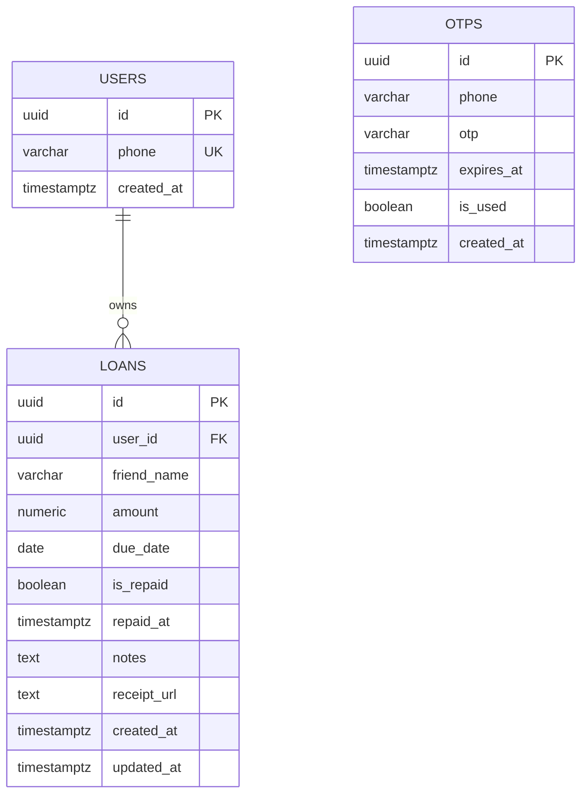

# MiniLedger 💳

A sleek, robust, full-stack application to track money lent to friends, monitor repayments, and highlight overdue balances in real time.

Built as an engineering assignment with **clean architecture**, **strong typing**, and **explainable code**.

---

## 🌟 Highlights & Feature Checklist

| Requirement | Implementation Status | Details |
| :--- | :---: | :--- |
| **Backend: Phone Login + Mock OTP** | ✅ Completed | OTP generated, saved in DB with 5-min expiry, and logged to server console. |
| **Backend: Add Loan Entry** | ✅ Completed | Friend name, amount, due date, notes, plus receipt attachment support. |
| **Backend: Mark as Repaid** | ✅ Completed | Updates `is_repaid` to true and logs repayment timestamp `repaid_at`. |
| **Backend: Summary Endpoint** | ✅ Completed | Computes `totalLent`, `totalRepaid`, and `overdueAmount` in real-time SQL. |
| **App: Phone + OTP Login Screen** | ✅ Completed | Clean step-by-step UI with instant mock OTP autofill helper for dev testing. |
| **App: Summary Card at Top** | ✅ Completed | Hero total lent card + sub-metrics for repaid, overdue, and pending amounts. |
| **App: List with Overdue Highlighted** | ✅ Completed | Overdue cards feature vibrant alert banners, red borders, and countdown tags. |
| **App: Add Entry Form** | ✅ Completed | Bottom sheet modal with date presets (+3d, +7d, +30d), validation, and camera/gallery. |
| **Bonus: Receipt Photo Upload** | ✅ Completed | Multipart upload via Multer + full-screen receipt preview modal in the app. |
| **Bonus: Input Validation** | ✅ Completed | Zod validation schemas on backend + immediate client-side form validation. |
| **Bonus: Integration Tests** | ✅ Completed | 15 automated integration tests with Jest and Supertest (`npm test`). |

---

## 🏛️ System Architecture

MiniLedger follows **Layered Clean Architecture** for maximum maintainability and ease of explanation:

```
MiniLedger/
├── backend/                  # Node.js + TypeScript + Express + PostgreSQL
│   ├── src/
│   │   ├── config/           # Environment variables & runtime configuration
│   │   ├── controllers/      # HTTP request handling & status codes
│   │   ├── services/         # Core business logic & database queries
│   │   ├── routes/           # Express router endpoints
│   │   ├── middleware/       # JWT auth, Zod validation, file uploads, error handling
│   │   ├── validators/       # Zod schemas for request validation
│   │   ├── types/            # TypeScript interfaces & types
│   │   ├── db/               # PostgreSQL pool connection, schema.sql, migrate, seed
│   │   ├── app.ts            # Configured Express application (exported for tests)
│   │   └── index.ts          # Server entry point with startup migrations
│   ├── tests/                # Automated Jest & Supertest integration tests
│   └── uploads/              # Attached receipt photos
├── frontend/                 # React Native (Expo) + TypeScript
│   ├── src/
│   │   ├── components/       # SummaryCards, LoanCard, AddLoanModal, ReceiptModal, SearchBar
│   │   ├── context/          # AuthContext (JWT management & AsyncStorage)
│   │   ├── screens/          # LoginScreen, HomeScreen
│   │   ├── services/         # API fetch client with dynamic base URL
│   │   ├── theme/            # Design tokens, color palette, typography, shadows
│   │   └── utils/            # Currency formatting (₹), date helpers, relative due status
│   └── App.tsx               # Root entry point with SafeAreaProvider & AuthProvider
└── docker-compose.yml        # One-command PostgreSQL 16 container setup
```

---

## 💾 Database Schema

PostgreSQL tables created via [`backend/src/db/schema.sql`](file:///d:/dev/miniledger/MiniLedger/backend/src/db/schema.sql):



### Overdue Logic:
A loan is calculated as overdue if:
$$\text{is\_repaid} = \text{false} \quad \text{AND} \quad \text{due\_date} < \text{CURRENT\_DATE}$$

---

## 🚀 Quick Start Guide

### Prerequisites
- **Node.js** (v18+ recommended, v22 supported)
- **PostgreSQL** (running locally on port 5432, or using Docker)

---

### Step 1: Clone and Set Up the Database

```bash
git clone https://github.com/anandshukla15/MiniLedger.git
cd MiniLedger
```

#### Option A: Using Docker (Fastest)
```bash
docker compose up -d
```
*Spins up a PostgreSQL 16 instance on `localhost:5432` with user `postgres` and password `pass`.*

#### Option B: Using Existing Local PostgreSQL
Ensure a database named `miniledger_db` exists:
```bash
# In psql or pgAdmin:
CREATE DATABASE miniledger_db;
```

---

### Step 2: Configure & Start the Backend

```bash
cd backend
npm install
```

Configure `backend/.env` (a ready-to-use template is provided):
```env
PORT=5000
DB_HOST=localhost
DB_PORT=5432
DB_NAME=miniledger_db
DB_USER=postgres
DB_PASS=pass
JWT_SECRET=miniledger_super_secure_jwt_secret_key_2026
JWT_EXPIRES_IN=7d
NODE_ENV=development
```

#### Run Database Migrations & Demo Seed Data:
```bash
# 1. Run migrations to create tables and indexes
npm run db:migrate

# 2. (Optional) Seed realistic demo loans & overdue entries
npm run db:seed
```

#### Start the Server:
```bash
npm run dev
```
The server will start at **`http://localhost:5000`**.

---

### Step 3: Run the Automated Integration Tests

In the `backend/` directory:
```bash
npm test
```
All **15 tests** run against the database verifying:
- Mock OTP generation and server logging
- JWT authentication
- Input validation (e.g. negative amounts, empty names, invalid dates)
- Loan creation, overdue status calculation, repayment marking
- Summary metrics calculation (`totalLent`, `totalRepaid`, `overdueAmount`)
- Receipt photo multipart attachment

---

### Step 4: Run the React Native App

In a new terminal window:
```bash
cd frontend
npm install
```

#### To Run in Web Browser (Instant Review):
```bash
npm run web
```
Opens in your browser at **`http://localhost:8081`**.

#### To Run on Mobile:
```bash
# For Android:
npm run android

# For iOS (macOS required):
npm run ios

# Or scan the Expo QR code using the Expo Go mobile app:
npx expo start
```

---

## 📱 Testing the Flow

1. **Sign In**:
   - Enter your phone number (e.g., `+919876543210` or click **"Use Demo Number"**).
   - Click **Get Mock OTP**.
   - Observe the mock OTP printed prominently in the **backend server terminal**:
     ```
     ======================================================
      [MiniLedger OTP Service]
      Phone Number: +919876543210
      MOCK OTP CODE: >>> 657440 <<<
      Valid Until: 1:36:04 am
     ======================================================
     ```
   - Enter the 6-digit code (or click **"Fill Dev Test OTP: 123456"**).
   - Click **Verify & Enter App**.

2. **Dashboard Overview**:
   - The top summary cards show:
     - **Total Money Lent** (large headline amount + progress bar)
     - **Total Repaid** (green card)
     - **Overdue Amount** (vibrant red card with count of overdue entries)
     - **Pending Amount** (to be collected)
   - Entries that are past their due date have **red highlighted borders**, an **"ALERT: PAYMENT OVERDUE"** header, and an overdue day counter.

3. **Record a New Loan**:
   - Tap **"+ Add Loan"** in the top bar or floating action button.
   - Enter friend name (e.g., `Aarav Mehta`), amount (e.g., `2500`), pick a due date or quick preset (`+1 Week`), add optional notes, or attach a receipt photo.
   - Tap **Save Loan Entry**.
   - Notice the list and top summary card instantly update!

4. **Mark as Repaid**:
   - Tap the **"Repaid"** button on any active loan.
   - The entry transitions to settled with a strikethrough, and `Total Repaid` increases while `Overdue` / `Pending` adjusts automatically.

5. **Search & Filter**:
   - Switch between **All**, **Overdue**, **Pending**, and **Repaid** tabs.
   - Type in the search bar to find loans by friend's name.

---

## 📡 API Reference

### Authentication
| Method | Endpoint | Description | Sample Body |
| :--- | :--- | :--- | :--- |
| `POST` | `/api/auth/send-otp` | Request mock OTP (logs to console) | `{"phone": "+919876543210"}` |
| `POST` | `/api/auth/verify-otp` | Verify OTP & receive JWT | `{"phone": "+919876543210", "otp": "657440"}` |
| `GET` | `/api/auth/me` | Fetch authenticated user profile | Header: `Bearer <token>` |

### Loans & Summary
| Method | Endpoint | Description | Sample Query / Body |
| :--- | :--- | :--- | :--- |
| `GET` | `/api/loans/summary` | Return summary metrics | None |
| `GET` | `/api/loans` | List loans with filters | `?status=all\|overdue\|pending\|repaid&search=Rahul` |
| `POST` | `/api/loans` | Create loan entry (+ optional receipt) | `{"friend_name": "Rahul", "amount": 1500, "due_date": "2026-11-01"}` |
| `PATCH` | `/api/loans/:id/repay` | Mark loan as repaid | None |
| `DELETE` | `/api/loans/:id` | Delete loan record | None |

#### Sample Summary Response (`GET /api/loans/summary`):
```json
{
  "success": true,
  "data": {
    "summary": {
      "totalLent": 17600,
      "totalRepaid": 5500,
      "overdueAmount": 7500,
      "pendingAmount": 12100,
      "activeLoansCount": 4,
      "repaidLoansCount": 2,
      "overdueLoansCount": 2
    }
  }
}
```

---

## 💡 Key Design Decisions & Interview Notes

1. **Separation of Concerns (App vs Index)**:
   - `app.ts` initializes Express routes and middleware without calling `.listen()`.
   - `index.ts` handles database migration checks and socket listening.
   - This prevents port-binding collisions and hanging handles during Supertest executions.

2. **Database Performance & Indexes**:
   - Added compound indexes on `loans(user_id, is_repaid)` and `loans(user_id, due_date)` to ensure $O(\log n)$ response times on summary queries as loan records grow into tens of thousands.

3. **Accurate Currency Calculation**:
   - `NUMERIC(12, 2)` is used in PostgreSQL rather than floating point numbers to eliminate decimal rounding errors in financial transactions.

4. **Clean Cross-Platform Support**:
   - React Native components use standard safe area boundaries and responsive layouts so the app looks native on iOS, Android, and Web browsers.

---

## 📜 License
MIT License. Built with ❤️ by **Anand Shukla**.